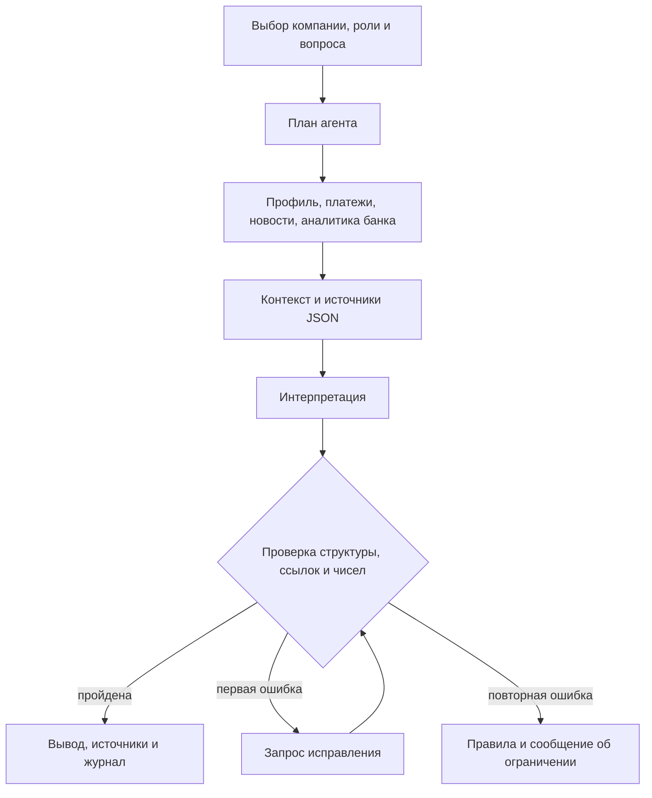

# Decision Brief

Персонализированная новостная аналитика для руководителей крупного бизнеса.
Решение сопоставляет события с компанией и ролью пользователя, показывает возможные
последствия и датированную позицию Альфа-Банка. Собственный агент собирает контекст,
вызывает инструменты, проверяет вывод и при необходимости повторяет генерацию.

**Для жюри:** [комплект сдачи и фиксация версии](SUBMISSION.md),
[сценарий проверки агента на 8501](docs/jury-scenario.md#автономная-проверка-прежнего-экрана-агента),
[ограничения и безопасность](docs/security-and-quality.md).

## Быстрый запуск

Нужны Docker Engine/Desktop и Docker Compose v2 с поддержкой `--wait`,
доступ к Docker Hub и PyPI **при первой сборке**, свободные порты 8780 и 8501.
Ориентир для демо: 2 CPU, 2 ГБ RAM, 2 ГБ диска. Это оценка, не результат нагрузочного теста.

```bash
git clone --branch submission/jury-ready https://github.com/BoytsovM/decision-brief.git
cd decision-brief
docker compose up --build --wait
```

Продуктовые экраны: **http://localhost:8780**.
Одна команда поднимает два процесса. `frontend` отдаёт экраны Альфа-Бизнеса.
`screen` оставляет прежний сценарий агента на **http://localhost:8501**.

На 8780 по умолчанию открываются **живые RSS**; для их загрузки нужен интернет.
Тот же режим доступен по **http://localhost:8780/?mode=live**.
Если загрузка RSS не удалась, сохраняется уже загруженная живая лента; при первом запуске
без доступных источников она остаётся пустой. Синтетические события её не подменяют.

Синтетический набор для проверки доступен отдельно: **http://localhost:8780/?mode=demo**.
В нём три вымышленные компании с выручкой свыше 15 млрд рублей, три роли,
шесть вымышленных событий и синтетические платежи. Дата сценария — **21.10.2026**.
Просмотр этого набора работает без интернета и без ключа LLM. Учётные записи не нужны.
Режим выбирается параметром `mode` в URL: см. `initialMode` в [web/app.js](web/app.js)
и `_mode_value`, `_items`, `combine_live` в [web_server.py](src/decision_brief/web_server.py).

С главной страницы откройте «События для вашего бизнеса» → «Все события», затем карточку.
В карточке отдельно показаны факт, связь с компанией, последствия, позиция банка и источник.
При настроенном шлюзе первое открытие карточки для выбранных компании и роли запрашивает
`/api/card-model`: модель формирует блок «Вывод модели» и вопрос клиенту.
Результат кешируется в памяти процесса. Кнопка «Ответить» отправляет показанный вопрос
в `/api/card-answer` и выводит ответ в карточке. После получения ответа появляется поле
«Хотите задать свой вопрос?» с кнопкой «Спросить»; оно также использует `/api/card-answer`.
Без ключа лента и последствия по правилам доступны, а блок модели сообщает, что шлюз не настроен;
ответы модели и поле собственного вопроса в этом случае недоступны.
Этот порядок реализован функциями `ensureCardModel`, `ownQuestionForm`, `askOwn` в
[web/app.js](web/app.js) и обработчиками `_card_model`, `_card_answer`, `_own_answer` в
[web_server.py](src/decision_brief/web_server.py).

```bash
docker compose logs --tail=100
docker compose down
```

## Сценарий за несколько минут

Экраны на http://localhost:8780:

1. На главной открыть «Все события», выбрать доступную компанию и роль казначея.
   Для воспроизводимой проверки на синтетических данных открыть `/?mode=demo` и выбрать перевозчика.
2. Открыть карточку. Сверить факт, связь с компанией, колонку последствий, датированную позицию банка и источник.
   При настроенном ключе блок «Вывод модели» заполняется ответом модели, под ним вопрос и кнопка «Ответить».
3. Сменить компанию и роль, сравнить состав и приоритеты событий. В синтетическом наборе
   можно выбрать общепит и роль собственника.
4. При настроенном шлюзе нажать «Ответить» под вопросом модели в карточке.
   После получения ответа в поле «Хотите задать свой вопрос?» ввести вопрос по этому событию
   и нажать «Спросить». Ответ появляется в той же карточке. Без настроенного шлюза этот шаг недоступен.

Экран агента на http://localhost:8501 принимает новую новость и вопрос,
запускает «Подготовить анализ», показывает журнал шагов и выгрузку JSON.
Без ключа он формирует интерпретацию по правилам; при настроенном шлюзе выполняет
агентный анализ с проверкой ответа и возможным исправлением.
Пошаговая проверка именно экрана на 8501 приведена в разделах «Автономная проверка прежнего
экрана агента» и «Проверка LLM с ключом организаторов» в [сценарии проверки](docs/jury-scenario.md).

## Подключение разрешённой LLM

Скопируйте `.env.example` в `.env`. Укажите адрес и ключ **шлюза, предоставленного организаторами**.
Ключ в Git не добавляется. `.env` автоматически читает Docker Compose.

```dotenv
DECISION_BRIEF_MODEL=GLM-5.3-Flash
DECISION_BRIEF_BASE_URL=https://your-case-gateway.example/v1
DECISION_BRIEF_API_KEY=replace-locally
```

Пример адреса выше — заглушка, его нужно заменить. Затем:

```bash
docker compose up -d --force-recreate
```

Допустимы только текстовые модели из PDF: `Gemma 4 26B A4B`, `GLM-5.3-Flash`,
`Qwen3.6 35B A3B`, `DeepSeek-V4.1-Flash`, `Kimi-K2.6`.
Регистр, дефисы и пробелы нормализуются; произвольные названия отвергаются.
Если шлюз использует другой идентификатор, сначала подтвердите его соответствие списку кейса.
`Qwen3-VL-30B-A3B-Instruct` зарезервирована для отдельного экспериментального скрипта
транскрипции, в рабочем текстовом сценарии не вызывается.

Просмотр ленты не расходует токены. На 8780 запрос вывода карточки, ответ на вопрос модели
и собственный вопрос используют отдельные вызовы модели; при наличии кешированного ответа
повторный вызов не выполняется. Автоматического запроса исправления в этих обработчиках нет.
Кнопка «Подготовить анализ» на 8501 и API `/api/analysis` используют `prepare_analysis` из
[agent.py](src/decision_brief/agent.py): до трёх событий и до двух запросов
(основной + исправление). Общие ограничения клиента — до 1200 выходных токенов на запрос
и таймаут 30 секунд, см. [conclusion.py](src/decision_brief/conclusion.py).
Суточный лимит задания — 500 ₽ на число токенов — стоит на шлюзе.
Приложение его не считает и тарифы шлюза не подменяет.

| Переменная | По умолчанию / назначение |
| --- | --- |
| `DECISION_BRIEF_PORT` | `8501`; порт экрана агента на локальном компьютере |
| `DECISION_BRIEF_WEB_PORT` | `8780`; порт продуктовых экранов на локальном компьютере |
| `DECISION_BRIEF_NEWS_MODE` | Для экрана 8501: `demo` по умолчанию, `live` выбирает RSS; на 8780 режим задаётся параметром `mode` в URL, по умолчанию `live` |
| `DECISION_BRIEF_MODEL` | Пусто; разрешённая текстовая модель |
| `DECISION_BRIEF_BASE_URL` | Пусто; HTTPS-адрес совместимого chat completions шлюза |
| `DECISION_BRIEF_API_KEY` | Пусто; секрет оператора |
| `DECISION_BRIEF_COMPANIES` | Путь к CSV компаний; в контейнере это путь **внутри** контейнера |
| `DECISION_BRIEF_PAYMENTS` | Путь к CSV платежей; для синтетических компаний подставляется синтетический файл |
| `PYTHONPATH` | `src` при локальном запуске; `/app/src` уже задан в Docker |

Пустые или недопустимые настройки модели оставляют интерпретацию по правилам на экране агента;
на 8780 доступны лента и последствия по правилам, а модельный блок сообщает о ненастроенном шлюзе.
При локальном запуске оба сервера автоматически читают `.env` из корня репозитория:
`_apply_local_env` в [app.py](src/decision_brief/app.py) и `_load_local_env` в
[web_server.py](src/decision_brief/web_server.py). Они подхватывают переменные `DECISION_BRIEF_*`,
если те ещё не заданы в окружении процесса. После изменения `.env` локальные серверы нужно перезапустить;
при запуске через Compose — пересоздать контейнеры командой выше.

## Архитектура

Два контейнера из одного образа. `frontend` — экраны из `web/` и API `web_server.py`.
`screen` — прежний экран Streamlit. Отдельная БД не требуется.

Схема ниже описывает `prepare_analysis` из [agent.py](src/decision_brief/agent.py),
который используется экраном на 8501 и `/api/analysis`. Карточка на 8780 использует
отдельные обработчики `/api/card-model` и `/api/card-answer`, описанные выше.



| Компонент | Роль |
| --- | --- |
| `companies.py`, `counterparties.py` | Нормализация CSV, пропуски профиля и значимые платёжные связи |
| `feeds.py`, `classify.py` | RSS, устранение дублей по ссылке, классификация факторов |
| `scoring.py`, `roles.py` | Скор по отрасли, признакам компании и роли; пороги 0,3 и 0,6 |
| `bank_cards.py` | Датированные пересказы материалов кейса, ссылки и проверенные страницы |
| `agent.py` | Собственная оркестрация: план, инструменты, поиск по вопросу, проверка, ограниченное исправление |
| `conclusion.py` | Шлюз LLM, allowlist, TLS, ограничения ответа |
| `web_server.py`, `web/` | Экраны для жюри: главная, лента, карточка, профиль, источник |
| `app.py` | Прежний экран: лента, формы, журнал, JSON, обратная связь |
| `brief_pass.py`, `pipeline.py`, `screen.py` | Сохранённые базовые функции предыдущей версии и тесты |

Веса ранжирования — **экспертные допущения**, не обученная модель и не доказательство точности.
Материалы старше года и материалы с будущей датой исключаются. Новости без даты не получают
выдуманную дату «сегодня». Неполные поля отмечаются отдельно; направление импорта/экспорта,
доля рынка и идентичность реальной компании из обезличенного ID не выводятся.
Клиент, которого нет в справочнике, не получает выдуманный профиль.

Системные записи имеют идентификаторы: `C0` — клиент, `P0` — платежи,
`N1..N3` — выбранные события, `K1..K9` — материалы банка.
Каждый вывод LLM должен ссылаться на профиль и событие; доступная аналитика банка должна
быть использована хотя бы в одном выводе. Числа проверяются **по процитированным источникам**.
Слова пользователя не становятся источником новых числовых фактов.
Проверка не доказывает семантическую истинность или причинность — это задача экспертной оценки.

## Данные и первоисточники

- `data/sample/companies.csv`: пять вымышленных записей, три доступны в интерфейсе.
- `data/sample/payments.csv`: вымышленные связи, включая неизвестного контрагента.
- `data/sample/news.xml`: шесть вымышленных событий с адресами `example.invalid`.
- Материалы Альфа-Банка: краткие пересказы, происхождение и SHA-256 в
  [реестре источников](docs/bank-sources.json). Полные PDF не распространяются с решением.
- `tests/fixtures/rss/`: сохранённые примеры внешних публикаций из исходной версии для регрессии.
- Полные CSV кейса и связанные физлица не входят в Git/Docker; каталог `data/raw/` игнорируется.

### Сбор, разбор и классификация материалов

**Внешние новости.** В [feeds.py](src/decision_brief/feeds.py) задан список шести RSS-лент.
`fetch_rss` скачивает каждый документ с проверкой TLS и ограничением размера 2 МБ.
`decode_rss` выбирает кодировку по XML-декларации, затем HTTP-заголовку или UTF-8.
`parse_rss` разбирает RSS 2.0 через `xml.etree.ElementTree` и извлекает заголовок,
описание, дату публикации и ссылку. Записи без заголовка, корректной даты или HTTP(S)-ссылки
пропускаются. Источник определяется по адресу ленты. Для каждой записи создаётся `NewsItem`;
факторы определяет `factors_in_text` из [classify.py](src/decision_brief/classify.py)
по словам в заголовке и описании. `load_feeds` объединяет результаты,
пропускает недоступные ленты и удаляет дубли по ссылке через `dedupe_by_link`.
HTML-разметка описаний очищается при подготовке данных интерфейса функцией `plain_text` в
[web_api.py](src/decision_brief/web_api.py). Используется описание из RSS, полная статья по ссылке
при этом автоматически не скачивается.

**Аналитика Альфа-Банка.** Материалы кейса подготовлены как структурированные карточки
`BANK_CARDS` в [bank_cards.py](src/decision_brief/bank_cards.py). Карточка хранит название,
дату, имя исходного PDF, тематические факторы, краткий пересказ и отдельные тезисы.
Ссылки и страницы добавляются из `_PROVENANCE`; в [реестре источников](docs/bank-sources.json)
зафиксированы SHA-256 исходных PDF и способ проверки — визуальная сверка указанных страниц.
Это предварительно подготовленный набор: во время работы сервиса новые PDF автоматически
не разбираются. `latest_card_for` выбирает актуальную карточку по фактору, отдавая приоритет
основной теме документа, затем дате. `cited_theses` связывает каждый тезис с идентификатором
карточки, файлом, датой и страницей; `position_text` собирает блок позиции банка.
Карточки с `fresh=False` исключаются из набора актуальных материалов.

**Отдельный разбор страниц PDF.** В проекте есть экспериментальный
[scripts/transcribe_gap_pages.py](scripts/transcribe_gap_pages.py) для карточек без указанной
страницы первоисточника. Скрипт ищет соответствующие PDF в `data/raw/` и переданных каталогах,
читает страницы через `pypdf`, извлекает крупнейшее изображение страницы и при настроенном
шлюзе отправляет его разрешённой модели `Qwen3-VL-30B-A3B-Instruct`.
`parse_transcription` из [chart_draft.py](src/decision_brief/chart_draft.py) разбирает JSON
с полями страницы, названия графика, ряда, числа, единицы и даты. Результат сохраняется
в `src/decision_brief/chart_transcription_draft.json` со статусом «не проверено»;
он не обновляет `BANK_CARDS` и не используется в пользовательских ответах.
Скрипт запускается отдельно и не входит в запуск приложения через Compose.

Для своих CSV используйте разделитель `;`, UTF-8/UTF-8-BOM и колонки из задания.
Обязательны `SYNTHETIC_U`, `MAINOKVED_CODE`, `REVENUE_COMPANY`.

```bash
docker compose run --rm --service-ports \
  -v ./data/raw:/app/data/raw:ro \
  -e DECISION_BRIEF_COMPANIES=/app/data/raw/df_Uid_data_hack.csv \
  -e DECISION_BRIEF_PAYMENTS=/app/data/raw/df_Uid_payment_hack.csv screen
```

Если платежей нет, не задавайте `DECISION_BRIEF_PAYMENTS`. Имена файлов платежей в приложении
к PDF указаны неоднозначно: ориентируйтесь на колонки `PAYER;BENEFICIARY;PAY_AMT;PAY_CNT`.

## Проверка и локальный запуск

Python **3.12.14**, образ Docker закреплён digest; полное дерево зависимостей — `requirements.txt`,
build backend закреплён в `pyproject.toml`. Проверка в том же образе:

```bash
docker compose run --rm --no-deps screen python -m unittest discover -s tests
```

Локально в Linux/macOS:

```bash
python3.12 -m venv .venv
.venv/bin/python -m pip install -r requirements.txt
.venv/bin/python -m pip check
PYTHONPATH=src .venv/bin/python -m unittest discover -s tests
PYTHONPATH=src .venv/bin/python -m streamlit run src/decision_brief/app.py
PYTHONPATH=src .venv/bin/python -m decision_brief.web_server
```

Windows PowerShell:

```powershell
py -3.12 -m venv .venv
.\.venv\Scripts\python -m pip install -r requirements.txt
$env:PYTHONPATH = "src"
.\.venv\Scripts\python -m unittest discover -s tests
.\.venv\Scripts\python -m streamlit run src/decision_brief/app.py
.\.venv\Scripts\python -m decision_brief.web_server
```

`streamlit` и `web_server` запускаются отдельно: каждая команда занимает свой терминал.

Тесты покрывают ранжирование, обработку источников, новый сценарий UI, изменение профиля,
добавление нового события, повторную генерацию, неверные ссылки/числа, отсутствующие данные и сбой шлюза.
Один старый тест пропускается: исходный XLSX с восемью экспертными эталонами не предоставлен.
Это ограничение оценки качества, а не замена теста успешной заглушкой.
CI дополнительно собирает контейнер, проверяет HTTP healthcheck и прогоняет тесты в нём.

## Границы прототипа

Это демонстрационный интерфейс Альфа-Бизнеса, а не интеграция с настоящим интернет-банком.
Вход без авторизации допустим только для синтетического демо. Порт Compose по умолчанию
доступен только с localhost. Для внешнего размещения нужны TLS и аутентификация;
полные клиентские данные без этого не подключайте.

Не реализованы промышленный SSO, постоянная БД, автоматический OCR/RAG по новым PDF,
фоновая загрузка/индексация источников, долговременная обратная связь и нагрузочное масштабирование.
Схема их добавления и метрики описаны в `docs/security-and-quality.md`.
Сторонние компоненты, модельные ограничения и смоделированные интеграции:
[THIRD_PARTY_NOTICES](THIRD_PARTY_NOTICES).
