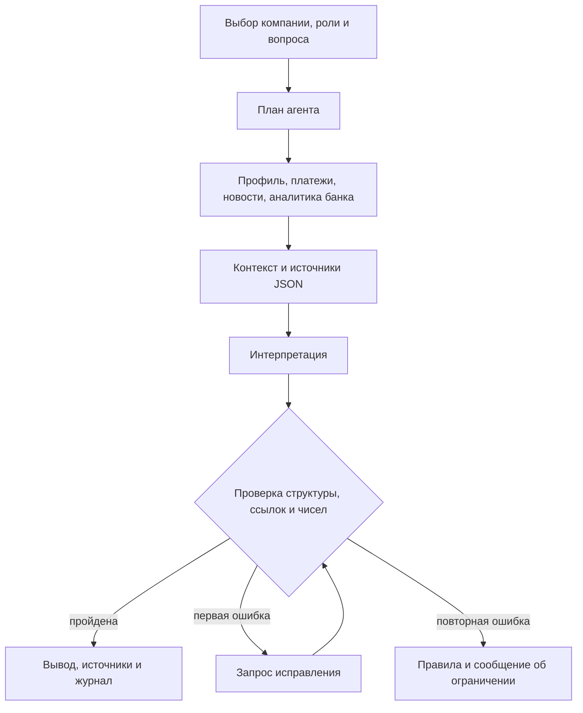

# Decision Brief

Персонализированная новостная аналитика для руководителей крупного бизнеса.
Решение сопоставляет события с компанией и ролью пользователя, показывает возможные
последствия и датированную позицию Альфа-Банка. Собственный агент собирает контекст,
вызывает инструменты, проверяет вывод и при необходимости повторяет генерацию.

**Для жюри:** [комплект сдачи и фиксация версии](SUBMISSION.md),
[сценарий проверки](docs/jury-scenario.md), [ограничения и безопасность](docs/security-and-quality.md).

## Быстрый запуск

Нужны Docker Engine/Desktop и Docker Compose v2 с поддержкой `--wait`,
доступ к Docker Hub и PyPI **при первой сборке**, свободный порт 8501.
Ориентир для демо: 2 CPU, 2 ГБ RAM, 2 ГБ диска. Это оценка, не результат нагрузочного теста.

```bash
git clone --branch submission/jury-ready https://github.com/BoytsovM/decision-brief.git
cd decision-brief
docker compose up --build --wait
```

Откройте **http://localhost:8501** → **Открыть бизнес-аналитику**.
Есть три синтетические компании с выручкой свыше 15 млрд рублей, три роли, шесть вымышленных событий и синтетические платежи.
Учётные записи не нужны. Ключ LLM не требуется. После сборки демонстрационный режим
работает без интернета. Его дата закреплена: **21.10.2026**, события не «протухают» со временем.

Без LLM показывается **интерпретация по правилам** с источниками и аналитикой банка.
Это полноценный сценарий интерфейса, но не подтверждение качества языковой модели.
В режиме **Публичные RSS** читаются текущие источники и используется текущая дата.

```bash
docker compose logs --tail=100
docker compose down
```

## Сценарий за несколько минут

1. Открыть аналитику с главной страницы. Выбрать перевозчика `U_sample_transport`, роль «казначей».
2. Посмотреть вывод, отдельный блок банка, первоисточники и журнал шагов.
3. Сменить компанию на `U_sample_horeca`, затем роль на «собственник». Состав и порядок событий меняются.
4. В «Проверить новую новость или RSS-файл» добавить своё событие с датой не позднее даты сценария.
   Оно проходит тот же классификатор и ранжирование, что исходные новости.
5. Задать уточняющий вопрос, нажать «Подготовить анализ». Тематический повторный поиск виден в журнале.
   Без LLM свободный ответ ограничен правилами; с LLM вопрос входит в запрос с тем же контекстом компании.
6. Скачать JSON с источниками, выводами и трассировкой. Оценить полезность; оценка доступна для выгрузки.

## Подключение разрешённой LLM

Скопируйте `.env.example` в `.env`. Укажите адрес и ключ **шлюза, предоставленного организаторами**.
Ключ в Git не добавляется. `.env` автоматически читает Docker Compose.

```dotenv
DECISION_BRIEF_MODEL=GLM-5.3-Flash
DECISION_BRIEF_BASE_URL=https://your-case-gateway.example/v1
DECISION_BRIEF_API_KEY=replace-locally
```

Пример адреса выше — заглушка, его нужно заменить. Затем:

```bash
docker compose up -d --force-recreate
```

Допустимы только текстовые модели из PDF: `Gemma 4 26B A4B`, `GLM-5.3-Flash`,
`Qwen3.6 35B A3B`, `DeepSeek-V4.1-Flash`, `Kimi-K2.6`.
Регистр, дефисы и пробелы нормализуются; произвольные названия отвергаются.
Если шлюз использует другой идентификатор, сначала подтвердите его соответствие списку кейса.
`Qwen3-VL-30B-A3B-Instruct` зарезервирована для отдельного экспериментального скрипта
транскрипции, в рабочем текстовом сценарии не вызывается.

Просмотр ленты не расходует токены. Генерация запускается только по кнопке:
до трёх событий, до двух запросов (основной + исправление), до 1200 выходных токенов на запрос,
таймаут 30 секунд. Суточный денежный лимит 500 ₽ из задания контролируется на стороне
шлюза; приложение не знает тарифов и не заменяет его биллинг.
Реальный вызов невозможно проверить без выданных команде настроек.

| Переменная | По умолчанию / назначение |
| --- | --- |
| `DECISION_BRIEF_PORT` | `8501`; порт на локальном компьютере |
| `DECISION_BRIEF_NEWS_MODE` | `demo`; `live` выбирает RSS при входе |
| `DECISION_BRIEF_MODEL` | Пусто; разрешённая текстовая модель |
| `DECISION_BRIEF_BASE_URL` | Пусто; HTTPS-адрес совместимого chat completions шлюза |
| `DECISION_BRIEF_API_KEY` | Пусто; секрет оператора |
| `DECISION_BRIEF_COMPANIES` | Путь к CSV компаний; в контейнере это путь **внутри** контейнера |
| `DECISION_BRIEF_PAYMENTS` | Путь к CSV платежей; для синтетических компаний подставляется синтетический файл |
| `PYTHONPATH` | `src` при локальном запуске; `/app/src` уже задан в Docker |

Пустые или недопустимые настройки модели оставляют режим правил.
Для локального запуска `.env` не подхватывается автоматически: экспортируйте значения в окружение.

## Архитектура

Streamlit и Python работают в одном контейнере. Отдельная БД не требуется.



| Компонент | Роль |
| --- | --- |
| `companies.py`, `counterparties.py` | Нормализация CSV, пропуски профиля и значимые платёжные связи |
| `feeds.py`, `classify.py` | RSS, устранение дублей по ссылке, классификация факторов |
| `scoring.py`, `roles.py` | Скор по отрасли, признакам компании и роли; пороги 0,3 и 0,6 |
| `bank_cards.py` | Датированные пересказы материалов кейса, ссылки и проверенные страницы |
| `agent.py` | Собственная оркестрация: план, инструменты, поиск по вопросу, проверка, ограниченное исправление |
| `conclusion.py` | Шлюз LLM, allowlist, TLS, ограничения ответа |
| `app.py` | Главная страница, лента, формы, выводы, журнал, JSON, обратная связь |
| `brief_pass.py`, `pipeline.py`, `screen.py` | Сохранённые базовые функции предыдущей версии и тесты |

Веса ранжирования — **экспертные допущения**, не обученная модель и не доказательство точности.
Материалы старше года и материалы с будущей датой исключаются. Новости без даты не получают
выдуманную дату «сегодня». Неполные поля отмечаются отдельно; направление импорта/экспорта,
доля рынка и идентичность реальной компании из обезличенного ID не выводятся.
Клиент, которого нет в справочнике, не получает выдуманный профиль.

Системные записи имеют идентификаторы: `C0` — клиент, `P0` — платежи,
`N1..N3` — выбранные события, `K1..K9` — материалы банка.
Каждый вывод LLM должен ссылаться на профиль и событие; доступная аналитика банка должна
быть использована хотя бы в одном выводе. Числа проверяются **по процитированным источникам**.
Слова пользователя не становятся источником новых числовых фактов.
Проверка не доказывает семантическую истинность или причинность — это задача экспертной оценки.

## Данные и первоисточники

- `data/sample/companies.csv`: пять вымышленных записей, три доступны в интерфейсе.
- `data/sample/payments.csv`: вымышленные связи, включая неизвестного контрагента.
- `data/sample/news.xml`: шесть вымышленных событий с адресами `example.invalid`.
- Материалы Альфа-Банка: краткие пересказы, происхождение и SHA-256 в
  [реестре источников](docs/bank-sources.json). Полные PDF не распространяются с решением.
- `tests/fixtures/rss/`: сохранённые примеры внешних публикаций из исходной версии для регрессии.
- Полные CSV кейса и связанные физлица не входят в Git/Docker; каталог `data/raw/` игнорируется.

Для своих CSV используйте разделитель `;`, UTF-8/UTF-8-BOM и колонки из задания.
Обязательны `SYNTHETIC_U`, `MAINOKVED_CODE`, `REVENUE_COMPANY`.

```bash
docker compose run --rm --service-ports \
  -v ./data/raw:/app/data/raw:ro \
  -e DECISION_BRIEF_COMPANIES=/app/data/raw/df_Uid_data_hack.csv \
  -e DECISION_BRIEF_PAYMENTS=/app/data/raw/df_Uid_payment_hack.csv screen
```

Если платежей нет, не задавайте `DECISION_BRIEF_PAYMENTS`. Имена файлов платежей в приложении
к PDF указаны неоднозначно: ориентируйтесь на колонки `PAYER;BENEFICIARY;PAY_AMT;PAY_CNT`.

## Проверка и локальный запуск

Python **3.12.14**, образ Docker закреплён digest; полное дерево зависимостей — `requirements.txt`,
build backend закреплён в `pyproject.toml`. Проверка в том же образе:

```bash
docker compose run --rm --no-deps screen python -m unittest discover -s tests
```

Локально в Linux/macOS:

```bash
python3.12 -m venv .venv
.venv/bin/python -m pip install -r requirements.txt
.venv/bin/python -m pip check
PYTHONPATH=src .venv/bin/python -m unittest discover -s tests
PYTHONPATH=src .venv/bin/python -m streamlit run src/decision_brief/app.py
```

Windows PowerShell:

```powershell
py -3.12 -m venv .venv
.\.venv\Scripts\python -m pip install -r requirements.txt
$env:PYTHONPATH = "src"
.\.venv\Scripts\python -m unittest discover -s tests
.\.venv\Scripts\python -m streamlit run src/decision_brief/app.py
```

Тесты покрывают ранжирование, обработку источников, новый сценарий UI, изменение профиля,
добавление нового события, повторную генерацию, неверные ссылки/числа, отсутствующие данные и сбой шлюза.
Один старый тест пропускается: исходный XLSX с восемью экспертными эталонами не предоставлен.
Это ограничение оценки качества, а не замена теста успешной заглушкой.
CI дополнительно собирает контейнер, проверяет HTTP healthcheck и прогоняет тесты в нём.

## Границы прототипа

Это демонстрационный интерфейс Альфа-Бизнеса, а не интеграция с настоящим интернет-банком.
Вход без авторизации допустим только для синтетического демо. Порт Compose по умолчанию
доступен только с localhost. Для внешнего размещения нужны TLS и аутентификация;
полные клиентские данные без этого не подключайте.

Не реализованы промышленный SSO, постоянная БД, автоматический OCR/RAG по новым PDF,
фоновая загрузка/индексация источников, долговременная обратная связь и нагрузочное масштабирование.
Схема их добавления и метрики описаны в `docs/security-and-quality.md`.
Сторонние компоненты, модельные ограничения и смоделированные интеграции:
[THIRD_PARTY_NOTICES](THIRD_PARTY_NOTICES).
